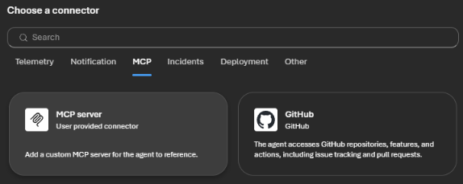
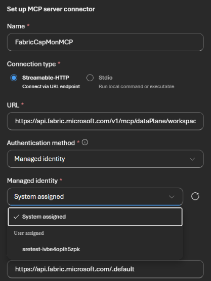
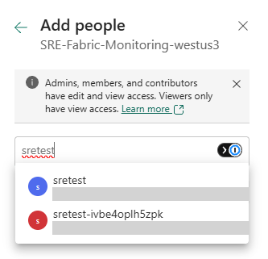
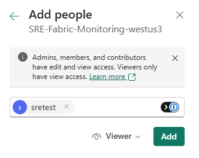
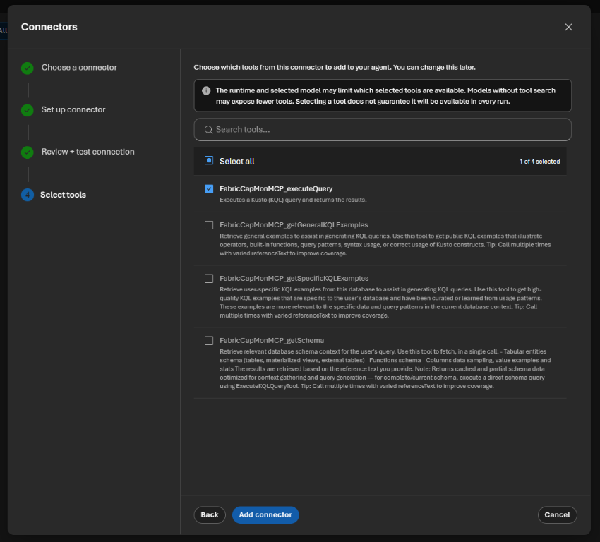
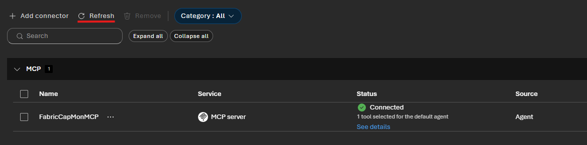

# Monitor Fabric capacity throttling with Azure SRE Agent

This walkthrough shows how to build a read-only monitor for Microsoft Fabric capacity throttling. It reports when throttling occurs, which operations show delays, what may have contributed, and what to investigate or change.

## Prerequisites

- **Fabric capacity:** Start with at least one active [Fabric capacity](https://learn.microsoft.com/en-us/fabric/enterprise/licenses).
- **Fabric setup permissions:**
  - **Subscribe to capacity events:** For new logging, you need [Capacity Admin on each monitored capacity](https://learn.microsoft.com/en-us/fabric/real-time-hub/fabric-events-subscribe-permission).
  - **Create telemetry items:** You need [Contributor, Member, or Admin](https://learn.microsoft.com/en-us/fabric/fundamentals/roles-workspaces) in the monitoring workspace.
  - **Create a new monitoring workspace:** Your account must be allowed by the Fabric tenant's [Create workspaces setting](https://learn.microsoft.com/en-us/fabric/admin/portal-workspace#create-workspaces). To create it on the chosen host capacity, you also need [Contributor or Admin on that capacity](https://learn.microsoft.com/en-us/rest/api/fabric/core/workspaces/create-workspace).
  - **Grant the agent read access:** If the connector's managed identity doesn't already have access, a workspace [Admin or Member](https://learn.microsoft.com/en-us/fabric/fundamentals/roles-workspaces) can grant it [Workspace Viewer](https://learn.microsoft.com/en-us/fabric/fundamentals/give-access-workspaces) in step 2. This applies to new and existing logs.
- **Azure SRE Agent:** You need an existing agent or permission to create one. The person adding the MCP connector needs the [SRE Agent Administrator role](https://learn.microsoft.com/en-us/azure/sre-agent/user-roles) on that agent.
- **Script only:** PowerShell 7.2+ and Azure CLI. On Windows, you can start from Windows PowerShell 5.1 and let the script offer to install missing tools.

## 1. Configure Fabric capacity monitoring

To monitor throttling, SRE Agent needs data about what is happening on the capacity. Fabric streams capacity events into tables in an Eventhouse, and SRE Agent queries those tables to detect throttling and investigate its impact.

Choose one option:

| Option | What to do |
| --- | --- |
| Use existing logging | If your Fabric capacity logging is already configured, skip to step 2. |
| Use the included script | Use [Install-FabricCapacityTelemetry.ps1](./Install-FabricCapacityTelemetry.ps1) to create the Fabric workspace, Eventhouse, tables, and eventstreams. |
| Set up logging manually | Follow the Microsoft Learn guides for [Capacity Overview events](https://learn.microsoft.com/en-us/fabric/real-time-hub/create-streams-fabric-capacity-overview-events) and [Capacity Operation events](https://learn.microsoft.com/en-us/fabric/real-time-hub/create-streams-fabric-capacity-operation-events). Route both feeds to separate tables in the same [Eventhouse KQL database](https://learn.microsoft.com/en-us/fabric/real-time-intelligence/event-streams/add-destination-kql-database). |

### Run the included script

Clone the repo or choose **Code > Download ZIP** on GitHub and extract it. Open PowerShell in the repo folder and run:

```powershell
.\Install-FabricCapacityTelemetry.ps1
```

The script offers to install missing tools through WinGet when available. Sign in to the Fabric tenant, select the capacities to monitor, and review the deployment plan.

**If `RemoteSigned` blocks a downloaded copy:** Review the script first. If you trust it and your organization allows it, unblock only that file and rerun:

```powershell
Unblock-File -LiteralPath .\Install-FabricCapacityTelemetry.ps1
.\Install-FabricCapacityTelemetry.ps1
```

This leaves the execution policy unchanged. If policy still blocks the script, use the manual setup or contact your administrator.

> [!IMPORTANT]
> **Save the SRE Agent handoff** from the script output. For each region, it lists the workspace, Eventhouse, database, and MCP URI. In step 2, use the MCP URI to set up the connector and the workspace and Eventhouse names to find where to grant its managed identity read access.

## 2. Connect SRE Agent to the logs

If you already have an agent you want to use, open it in the [SRE Agent portal](https://sre.azure.com). Otherwise, [create an Azure SRE Agent](https://learn.microsoft.com/en-us/azure/sre-agent/create-and-set-up), skip the in-product quickstart, and go straight to adding the MCP connector.

### Choose the connector identity in SRE Agent

Use the URI from the script or [find the MCP Server URI in Eventhouse](https://learn.microsoft.com/en-us/fabric/real-time-intelligence/mcp-remote-eventhouse#find-the-mcp-server-uri). Follow the Microsoft Learn guide to [add an MCP connector in SRE Agent](https://learn.microsoft.com/en-us/azure/sre-agent/mcp-connector) with these settings:



- **Name:** For example, `FabricCapMonMCP`
- **Connection type:** Streamable HTTP
- **Authentication:** Managed identity
- **Token scope:** `https://api.fabric.microsoft.com/.default`

**Choose one identity and grant access to that same identity in Fabric.**

| If you select this in SRE Agent | Search for this in Fabric |
| --- | --- |
| **System assigned** | The SRE Agent resource name, `sretest` in this example. |
| A **user-assigned** identity | The exact identity name shown in the dropdown, the `sretest-…` entry in this example. |



### Give that identity permission to query Fabric

For a dedicated monitoring workspace, open [**Manage access** on the workspace](https://learn.microsoft.com/en-us/fabric/fundamentals/give-access-workspaces) and select **Add people or groups**. Search for the same managed identity you selected in SRE Agent: `sretest` for **System assigned** in this example, not the similarly named user-assigned identity.



Select **Viewer**, then **Add**. Viewer lets the identity query KQL data without write access.



If access needs to be narrower, grant `Read` and `ReadData` on the Eventhouse to that identity instead of assigning workspace Viewer. `Read` alone isn't enough to query the tables.

### Test and add the connector

Return to SRE Agent and test the connection. If the test succeeds, the wizard opens **Select tools**. Deselect everything except the tool ending in `_executeQuery` (for example, `FabricCapMonMCP_executeQuery`), then select **Add connector**.



Repeat for each regional database you want to monitor.

On the **Connectors** page, select **Refresh**. Once your Fabric MCP connectors show **Connected**, proceed to step 3.



## 3. Create and verify the monitor

[Create a scheduled task](https://learn.microsoft.com/en-us/azure/sre-agent/create-scheduled-task) using the prompt below. Replace `<MCP connector name>` and `<capacity names>` with your connector name and the Fabric capacities you want to monitor.

> Use `<MCP connector name>` to monitor my Fabric capacities `<capacity names>`. Every 15 minutes, check for activity delays or throttling. If you find any, identify what was delayed or throttled, which workloads were running and may have contributed, and what we can change to prevent it from happening again.

Check the first scheduled run in **Automation** to confirm it queried both tables and posted a report.

### Optional: Email a report when an event is detected

To get automatic email notifications, [configure a notification connector](https://learn.microsoft.com/en-us/azure/sre-agent/connect-notification-service) before creating the scheduled monitor. Use this prompt instead, replacing all four placeholders:

> Use `<MCP connector name>` to monitor my Fabric capacities `<capacity names>`. Every 15 minutes, check for activity delays or throttling. If you find any, identify what was delayed or throttled, which workloads were running and may have contributed, and what we can change to prevent it from happening again. Email a report of those findings to `<email-address>` using the `<notification connector name>` connector. Do not send an email if no delays or throttling are detected.
